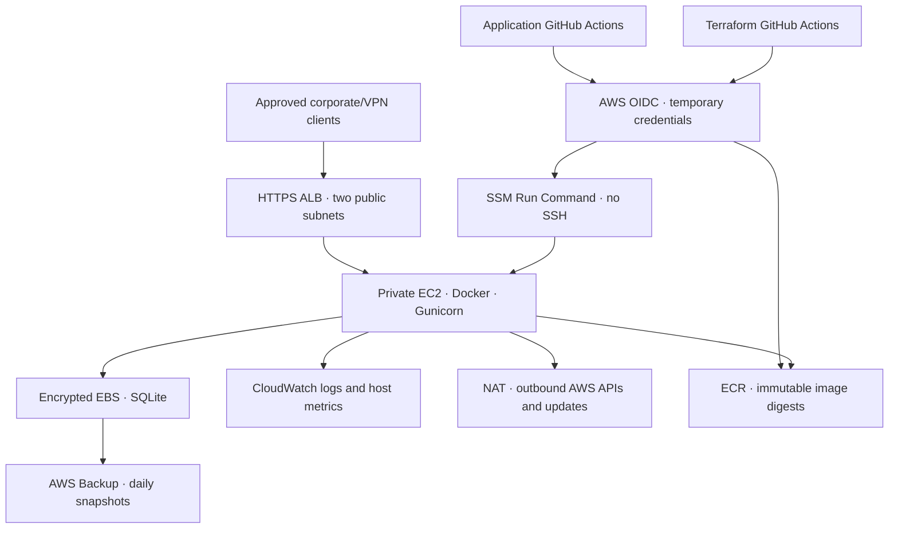

# Project 1 — AWS application and infrastructure delivery

A hands-on two-repository project based on the existing Flask Operations Console.

**Status:** implementation prepared; AWS bootstrap, account-specific settings and end-to-end deployment are still required. This is a hardened **single-host** baseline, not a highly available production service. SQLite is intentionally retained; no ASG or multiple independent database replicas are created.

## Architecture

The ALB spans two AZs but its single application target and EBS volume are in one AZ. A NAT gateway is provisioned in that AZ. NAT, ALB, EC2, EBS, logs and backups incur charges while idle. Size and price them in AWS Pricing Calculator before applying; this is not a free-tier design.

## Repository ownership

| Repository | Owns |
|---|---|
| `AWS-automation-app-repo` | Portal code, unit tests, Dockerfile, dependency locks, image scanning, ECR publishing, SSM delivery, code rollback |
| `aws-autoapp-infra-repo` | One-time account bootstrap, VPC, ALB, private EC2, EBS, instance IAM, monitoring, backups, Terraform pipeline |

## Environment contract

| Setting | dev | production |
|---|---|---|
| Deployment branch | `dev` | `production` |
| Terraform S3 key | `dev/terraform.tfstate` | `production/terraform.tfstate` |
| Network | `10.41.0.0/16` | `10.42.0.0/16` |
| EC2 | `t3.small` | `t3.medium` |
| Data EBS | 10 GiB | 50 GiB |
| Logs | 14 days | 90 days |
| Backup retention | 7 days | 35 days |
| App release | Build, test, scan, publish and deploy on push | Manually promote the digest currently healthy in dev |
| Deletion protections | Terraform prevents instance/data destruction | Same plus ALB deletion and EC2 termination protection |

Both environments initially use **one AWS account and region**, one shared ECR repository and separate VPCs, state keys and IAM roles. They are logically separated, not an account security boundary. Production account separation requires cross-account ECR access and a promotion manifest that does not read another account's local SSM parameter.

## Execution guide

Read [docs/SETUP.md](docs/SETUP.md), then [docs/OPERATIONS.md](docs/OPERATIONS.md). Complete the acceptance checklist before describing this as production ready.

## Production acceptance gates

- [ ] Terraform fmt, validate, reviewed plan, approved apply pass in GitHub.
- [ ] OIDC environment subject and branch allowlists reject the wrong branch and repo.
- [ ] Dev and production have different instance IDs, volume IDs, VPCs and Terraform state keys.
- [ ] HTTPS certificate and DNS match; only approved client CIDRs reach the portal.
- [ ] Container is healthy; ALB target is healthy; no public EC2 IP or SSH ingress exists.
- [ ] First-run setup completed by an authorized administrator before expanding CIDRs; MFA enabled.
- [ ] Runtime cross-account roles permit approved read operations only; remediation denied by default.
- [ ] Confirm SNS email; test unhealthy-host, memory and disk alarms.
- [ ] Verify CloudWatch log delivery and disk metrics after the data volume is mounted.
- [ ] Restore a backup into an isolated instance; verify SQLite integrity and login.
- [ ] Failed container release rolls back; database migrations have an independently tested rollback procedure.
- [ ] Pin and verify base/scanner image digests through your approved registry; review ongoing CVEs.
- [ ] Review provisioning-role permissions and workload isolation for your organization.
- [ ] Obtain acceptance of maintenance downtime, single-AZ failure exposure and recovery targets.

## Beyond this baseline

For HA production, first migrate storage, queries, migrations and session-key management to a shared database such as RDS PostgreSQL Multi-AZ. Then use EC2 Auto Scaling across private subnets in two AZs, controlled rolling or blue/green deployment, multi-AZ egress and load testing. **Do not put SQLite WAL on EFS or add replicas with independent SQLite files.** Add WAF, ALB access logs, VPC Flow Logs, organization CloudTrail, patch orchestration, image signing/provenance and centralized security controls according to enterprise requirements.

## Learning outcomes and interview evidence

1. Bootstrap state and OIDC; explain why initial bootstrap cannot authenticate with an IAM role that does not yet exist.
2. Plan/apply dev; explain public ALB versus private application routing, SG references, NAT and IMDSv2.
3. Merge application delivery; explain CI tests, vulnerability gates, immutable ECR tags and digest selection.
4. Promote to production; show the reviewed Terraform plan and environment approval history.
5. Break a release in dev; show SSM failure, automatic code rollback, alarms and a backup restore report.

Keep sanitized plan summaries, Actions run URLs, image digests, deployment IDs, alarm notifications and restore results as project evidence. Do not fabricate cost savings, uptime or production scale.

References: [GitHub OIDC on AWS](https://docs.github.com/en/actions/how-tos/secure-your-work/security-harden-deployments/oidc-in-aws), [Terraform S3 backend and lockfiles](https://developer.hashicorp.com/terraform/language/backend/s3), [AWS Backup EBS support](https://docs.aws.amazon.com/aws-backup/latest/devguide/working-with-supported-services.html).
